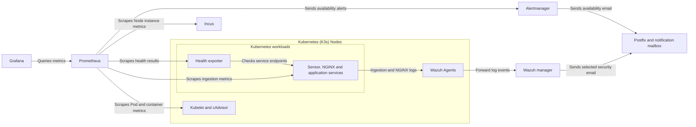
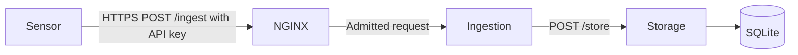

# Threat Monitoring

Threat Monitoring is a temperature telemetry application with availability monitoring and security controls. It accepts readings from a simulated sensor, stores them in SQLite, and exposes their average over HTTP.

## Architecture

### System overview

K3s runs the telemetry application and its health exporter. Prometheus, Grafana, Alertmanager, the Wazuh manager and the mail server run outside the cluster. Wazuh Agents on the K3s Nodes collect container logs.



### Reading path



Ingestion authenticates the sensor, validates the reading and acknowledges it after storage accepts the write. Analytics reads the count and sum from storage to calculate the average. Registry holds service registrations in memory. Ingestion registers at startup and uses its configured storage URL for requests.

In Kubernetes, NGINX runs alongside ingestion, terminates HTTPS and limits the request rate. Its metrics listener is separate from the ingestion listener. In local development the sensor connects directly to ingestion over HTTPS.

### K3s lab topology

The Kali lab runs K3s `v1.37.2+k3s1` on two Incus nodes in the same VM. Both nodes can run workloads.

| Node | Role | Internal IP |
| --- | --- | --- |
| `k3s-master` | Control plane and workload host | `10.255.255.10` |
| `k3s-node1` | Worker | `10.255.255.11` |

The cluster inventory on 2026-11-18 contained the following running Pods. The table uses Pod name prefixes because Kubernetes regenerates the suffixes.

| Node | Namespace | Pod name prefix | Containers |
| --- | --- | --- | --- |
| `k3s-master` | `kube-system` | `coredns` | `coredns` |
| `k3s-master` | `kube-system` | `local-path-provisioner` | `local-path-provisioner` |
| `k3s-master` | `kube-system` | `metrics-server` | `metrics-server` |
| `k3s-master` | `kube-system` | `svclb-traefik` | `lb-tcp-80`, `lb-tcp-443` |
| `k3s-master` | `kube-system` | `traefik` | `traefik` |
| `k3s-master` | `ssle` | `ssle-analytics` | `analytics` |
| `k3s-master` | `ssle` | `ssle-health-exporter` | `health-exporter` |
| `k3s-master` | `ssle` | `ssle-registry` | `registry` |
| `k3s-master` | `ssle` | `ssle-sensor` | `sensor` |
| `k3s-node1` | `kube-system` | `svclb-traefik` | `lb-tcp-80`, `lb-tcp-443` |
| `k3s-node1` | `ssle` | `ssle-ingestion` | `ingestion`, `nginx` |
| `k3s-node1` | `ssle` | `ssle-storage` | `storage` |

Ingestion uses a hostname selector for `k3s-node1`. The local volumes for ingestion and storage both have node affinity to `k3s-node1`. The remaining application Pods can move between nodes.

The running lab uses the `ssle` namespace. The [deployment manifests](deploy/k8s) use `threat-monitoring`.

Run these commands on Kali to check the current nodes, full Pod names, placement and containers.

```bash
incus exec --disable-stdin k3s-master -- k3s kubectl get nodes -o wide
incus exec --disable-stdin k3s-master -- k3s kubectl get pods -A \
  --field-selector=status.phase=Running --sort-by=.spec.nodeName \
  -o 'custom-columns=NODE:.spec.nodeName,NAMESPACE:.metadata.namespace,POD:.metadata.name,CONTAINERS:.spec.containers[*].name'
```

## Run locally

Use Python 3.13, the version used in the Docker images. From the repository root, create a virtual environment and install the [Python dependencies](requirements.txt).

```bash
# Create and activate an isolated Python environment
python3 -m venv .venv
source .venv/bin/activate

# Install the dependencies
python -m pip install --requirement requirements.txt
```

From the repository root, generate a lab certificate and register the local test sensor. This creates a key file for the sensor and a separate SQLite credentials database for ingestion.

```bash
bash deploy/tls/create-ingestion-tls.sh .ingestion-tls ingestion.lab.test
(umask 077 && python -m provision_sensor sensor-demo > .sensor-api-key)
```

Start each process in a separate terminal from the repository root. Activate the same environment in each terminal. Start registry and storage before ingestion.

| Command | Purpose |
| --- | --- |
| `python registry.py` | Register and list services |
| `python storage.py` | Store readings and return statistics |
| `INGESTION_TLS_CERT=.ingestion-tls/tls.crt INGESTION_TLS_KEY=.ingestion-tls/tls.key python ingestion.py` | Authenticate sensors and accept readings over HTTPS |
| `python analytics.py` | Serve the average temperature |
| `DEVICE_ID=sensor-demo SENSOR_API_KEY_FILE=.sensor-api-key INGESTION_CA_FILE=.ingestion-tls/ca.crt python sensor.py` | Send authenticated readings continuously |

To try the application with one reading, leave the sensor stopped. The first command writes a sample to local SQLite. The second reads the average of the stored readings.

```bash
# Submit one reading to the local ingestion service
printf 'Authorization: Bearer %s\n' "$(cat .sensor-api-key)" | curl --fail --silent --show-error \
  --cacert .ingestion-tls/ca.crt \
  --header @- \
  --header 'Content-Type: application/json' \
  --data '{"device_id":"sensor-demo","temperature":25.5}' \
  https://localhost:5001/ingest

# Read the current average from analytics
curl --fail --silent --show-error http://127.0.0.1:5003/average
```

Stop the processes with Ctrl+C. Storage keeps `readings.db` in its working directory and reuses it on the next start.

## Deploy to Kubernetes

The [manifests](deploy/k8s) target K3s and use the `threat-monitoring` namespace and a `local-path` storage class. Prepare both before applying the manifests.

1. Build the [application images](deploy/docker) from the repository root. Use the tags specified in the manifests and load each image, including the required NGINX image, on every Node eligible to run it. The workloads use `imagePullPolicy: Never`.
2. Apply the storage and [ingestion credentials](deploy/k8s/ingestion-devices-pvc.yaml) volume claims. Start storage and registry. Create the TLS resources below before applying the ingestion Deployment.
3. Start the remaining services. Register the Kubernetes sensor and create its API key Secret before applying the sensor Deployment.
4. Use the Node hosting the ingestion Pod for external HTTPS requests to the [ingestion NodePort](deploy/k8s/ingestion.yaml). Its local traffic policy preserves the client address at NGINX.

Storage and ingestion each keep a SQLite database on a separate persistent volume. Moving to another volume or namespace requires a data migration. The cluster-internal Storage Service allows traffic from the ingestion, analytics and health exporter Pods through a NetworkPolicy. Configure both external and internal sensors to use HTTPS.

### TLS and sensor keys on Kali

The commands below use the repository names. Adapt the namespace and Deployment names if the running lab uses different names. Run them in Bash on Kali from the repository root. The `kube` function runs K3s's bundled `kubectl` inside the `k3s-master` Incus container.

```bash
kube() { incus exec k3s-master -- k3s kubectl "$@"; }
incus exec k3s-master -- bash -s -- /root/ingestion-tls ingestion.lab.test \
  < deploy/tls/create-ingestion-tls.sh
kube -n threat-monitoring create secret tls ingestion-tls \
  --cert=/root/ingestion-tls/tls.crt --key=/root/ingestion-tls/tls.key
kube -n threat-monitoring create configmap ingestion-ca \
  --from-file=ca.crt=/root/ingestion-tls/ca.crt
```

Use a fresh directory for certificate generation. Keep the lab CA private key outside application containers and Git. The certificate covers `ingestion` for the in-cluster sensor and `ingestion.lab.test` for the Incus sensor. Resolve the latter on the Incus sensor to the address of the Node hosting the ingestion Pod. Apply the credentials claim and ingress resources from Kali by streaming the files to `kube`.

```bash
kube apply -f - < deploy/k8s/ingestion-devices-pvc.yaml
kube apply -f - < deploy/k8s/ingestion.yaml
kube -n threat-monitoring rollout status deployment/ingestion
```

Run the following in a Bash subshell to register the Kubernetes sensor. The API key goes from the administrator command into a Kubernetes Secret via standard input.

```bash
(
  set +x
  set -e
  device_key=$(kube -n threat-monitoring exec deployment/ingestion -c ingestion -- \
    python -m provision_sensor sensor-k8s-001)
  [[ ${#device_key} -eq 43 ]]
  printf '%s\n' "$device_key" | kube -n threat-monitoring create secret generic sensor-api-key \
    --from-file=ingestion-api-key=/dev/stdin
)
kube apply -f - < deploy/k8s/sensor.yaml
```

### Run a sensor outside K3s

On Kali, create a separate Incus container and map the certificate's DNS name to the Node hosting the ingestion Pod. Run this block once for a new container. Recheck the address if the Pod moves.

```bash
(
  set -e
  node_ip=$(kube -n threat-monitoring get pods -l app=ingestion \
    -o jsonpath='{.items[0].status.hostIP}')
  [[ -n "$node_ip" ]]
  incus launch images:debian/13 lab-sensor-a
  incus exec lab-sensor-a -- apt-get update
  incus exec lab-sensor-a -- apt-get install -y python3 python3-requests
  incus exec lab-sensor-a -- sh -c 'printf "%s %s\n" "$1" "$2" >> /etc/hosts' \
    sh "$node_ip" ingestion.lab.test
)
```

Copy `sensor.py`, the public CA certificate and a key registered specifically for this container. Use `/etc/ingestion-auth` for the standalone Incus sensor so its key survives a restart.

```bash
incus file push sensor.py lab-sensor-a/root/sensor.py
mkdir -p .ingestion-tls
incus file pull k3s-master/root/ingestion-tls/ca.crt .ingestion-tls/ca.crt
incus file push -p .ingestion-tls/ca.crt lab-sensor-a/etc/ingestion-ca/ca.crt
(
  set +x
  set -e
  device_key=$(kube -n threat-monitoring exec deployment/ingestion -c ingestion -- \
    python -m provision_sensor sensor-A)
  [[ ${#device_key} -eq 43 ]]
  printf '%s\n' "$device_key" | incus file push -p --uid=0 --gid=0 --mode=0400 \
    - lab-sensor-a/etc/ingestion-auth/ingestion-api-key
)
incus exec lab-sensor-a -- env DEVICE_ID=sensor-A \
  INGESTION_URL=https://ingestion.lab.test:30502/ingest \
  SENSOR_API_KEY_FILE=/etc/ingestion-auth/ingestion-api-key \
  INGESTION_CA_FILE=/etc/ingestion-ca/ca.crt python3 /root/sensor.py
```

To revoke a sensor, run `python -m provision_sensor --revoke DEVICE_ID` in the ingestion container. The next request checked by ingestion with that key returns HTTP 401. To replace an active or lost key, use `--rotate`, distribute the returned replacement and restart the sensor process so it reads the new file. Rotation invalidates the old key as soon as the new hash is committed. Keep API keys out of command arguments, terminal output, Git and application logs. See the [report note](SENSOR-AUTHENTICATION.md) for what the mitigation covers and how to verify it.

## Monitoring and notifications

- Prometheus scrapes application health, ingestion request metrics and resource metrics. Its availability rules cover failed health checks, missing monitoring data and stopped readings. [Scrape configuration](monitoring/prometheus/prometheus.yml), [availability rules](monitoring/prometheus/rules/availability.yml)
- Grafana displays application health and resource use at Node, Pod and container level. [Dashboards and provisioning](monitoring/grafana)
- Alertmanager sends firing and resolved availability notifications through Postfix over SMTP with STARTTLS. Wazuh sends selected security alerts to the same mail service over plain SMTP on the private network. [Alertmanager configuration](monitoring/alertmanager/alertmanager.yml), [Wazuh mail settings](deploy/wazuh/project-email.conf)

Install the monitoring and mail services separately from the application workloads. Set scrape targets, the Grafana data source and SMTP settings for the deployment. The supplied Prometheus configuration expects Alertmanager on loopback. Configure the listener accordingly when they run on the same host.

The resource scrape jobs use a metrics client certificate for Incus and a dedicated ServiceAccount for kubelet metrics. Provision credentials and trusted certificates outside the repository. [Kubelet access manifest](deploy/k8s/kubelet-metrics-access.yaml)

## Security controls

| Event | Response | Configuration |
| --- | --- | --- |
| Repeated invalid readings | Ingestion rejects invalid readings. Wazuh correlates repeated rejections and temporarily blocks the source IP on the reporting Node. | [Ingestion rules](deploy/wazuh/ingestion-rules.xml), [Active Response](deploy/wazuh/ingestion-active-response.conf) |
| Missing, invalid or misused sensor credentials | Ingestion rejects the reading before it reaches Storage. Wazuh alerts on the rejection and temporarily blocks the source IP on the reporting Node when failures repeat. | [Sensor authentication](SENSOR-AUTHENTICATION.md), [Ingestion rules](deploy/wazuh/ingestion-rules.xml), [Active Response](deploy/wazuh/ingestion-active-response.conf) |
| Excess ingestion traffic | NGINX rejects requests above its shared rate budget for the Pod. Wazuh records and counts the rejections. | [NGINX configuration](deploy/k8s/ingestion.yaml), [Wazuh rules](deploy/wazuh/nginx-rules.xml) |
| Apache request from a listed source IP | Wazuh temporarily blocks that IP on the Apache agent. Wazuh also detects Shellshock attempts in the access log. | [Apache IP reputation](APACHE-IP-REPUTATION.md) |
| Spam sent to the notification mailbox | SpamAssassin marks spam and Procmail delivers it to Junk. Wazuh raises an alert from the mail log for each detection. Dovecot provides access to the mailbox over IMAP. | [Mail configuration](deploy/mail), [Wazuh mail rule](deploy/wazuh/mail-rules.xml) |

Install the Wazuh collectors on the hosts that produce the logs, and install the decoders and rules on the manager. Merge the settings for `ossec.conf` into the existing configuration. [Wazuh configuration](deploy/wazuh)
