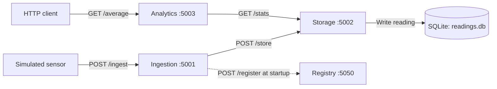
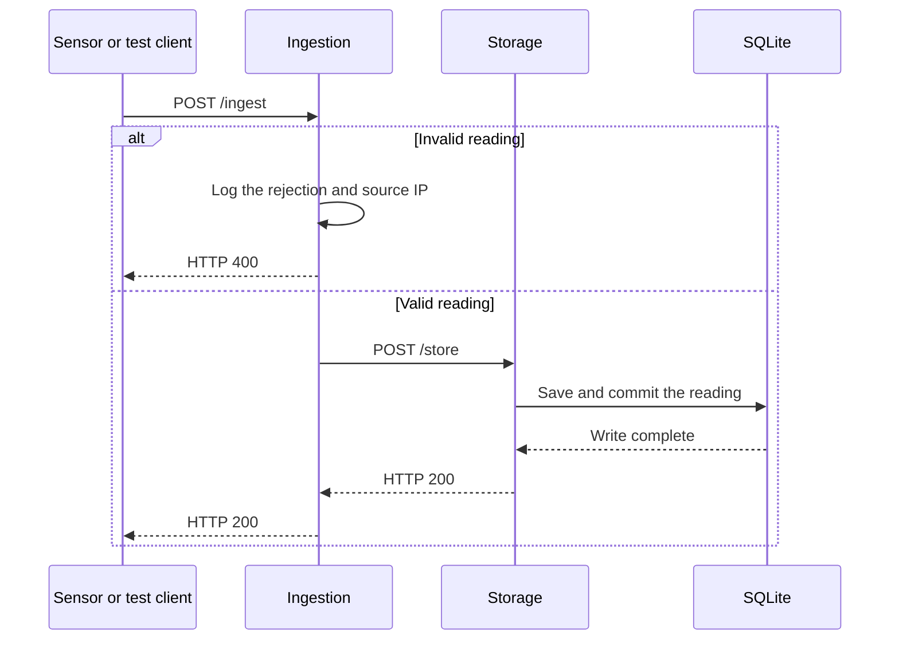
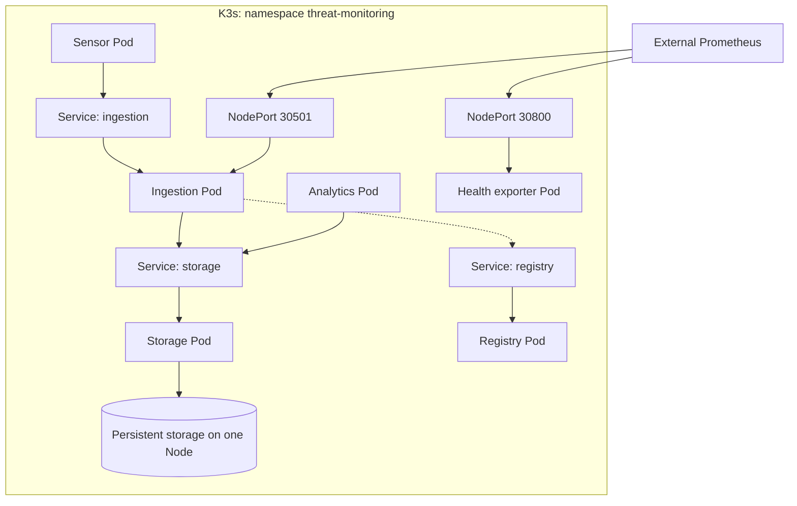
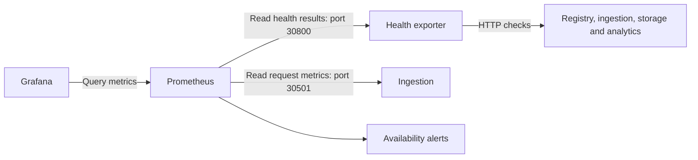
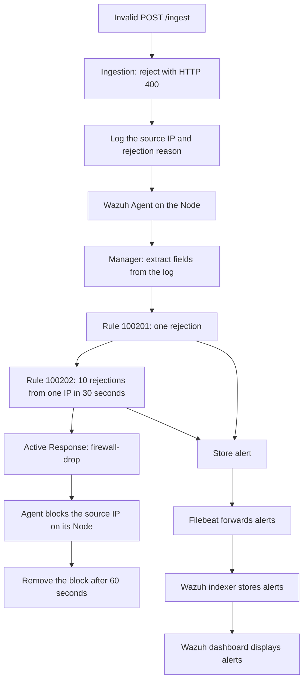

# Threat Monitoring

This project combines a temperature-reading application with availability monitoring and security detection. It uses Prometheus and Grafana to show service health, and Wazuh to detect repeated invalid requests and temporarily block their source IP.

The repository contains the application, Dockerfiles, Kubernetes manifests and monitoring configuration. The K3s cluster, Incus containers and monitoring servers are set up separately. Saving a configuration here does not apply it to a running deployment.

## How a reading moves through the application



The sensor generates a temperature between 20 and 30 and sends it to ingestion. Ingestion checks the reading before it reaches storage. Storage owns the database, and analytics asks storage for the count and sum needed to calculate the average.

Registry keeps the latest URL and registration time for each service name. Registering the same name replaces its previous entry. Only ingestion registers automatically. Ingestion uses its configured storage URL directly; registry is not consulted for each reading. Registry entries are held in memory and are lost on restart.

| Component | Source | Role |
| --- | --- | --- |
| Sensor | [sensor.py](sensor.py) | Generates and sends readings |
| Ingestion | [ingestion.py](ingestion.py) | Validates readings and forwards accepted data |
| Storage | [storage.py](storage.py) | Saves readings and returns database statistics |
| Analytics | [analytics.py](analytics.py) | Calculates the average from storage statistics |
| Registry | [registry.py](registry.py) | Stores and exposes service registrations |
| Health exporter | [monitoring/health_exporter.py](monitoring/health_exporter.py) | Checks the HTTP services and publishes their latest health results |

A reading has this form:

```json
{
  "device_id": "sensor-001",
  "temperature": 25.5
}
```

Ingestion requires a JSON object, a non-empty device ID and a numeric temperature. It rejects booleans as temperatures. It does not check physical temperature limits or authenticate the sender. Storage relies on these checks rather than repeating them.



Ingestion reports success only after storage accepts the reading. A storage connection failure or unsuccessful response produces HTTP 502. A timeout produces HTTP 504; this does not prove whether storage saved the reading. There is no queue, automatic retry or duplicate detection.

The sensor waits five seconds after each request finishes and discards failed readings. Analytics also uses a five-second request timeout. It returns HTTP 502 for unavailable or invalid storage results, and HTTP 504 for a timeout. Without readings, storage returns a count and sum of zero, and analytics returns a null average.

## Run the application locally

Use Python with `venv` and `pip`; the Dockerfiles use Python 3.13. From the repository root, create an isolated environment and install [requirements.txt](requirements.txt). Dependency versions are not pinned.

```bash
# Create a local Python environment
python3 -m venv .venv

# Activate it in this terminal
source .venv/bin/activate

# Install the application dependencies in that environment
python -m pip install --requirement requirements.txt
```

Open one terminal per service, from the repository root, and activate the same environment in each. Start registry and storage first, then ingestion and analytics, and finally the sensor.

| Start order | Command | Local address |
| --- | --- | --- |
| 1 | `python registry.py` | `http://127.0.0.1:5050` |
| 2 | `python storage.py` | `http://127.0.0.1:5002` |
| 3 | `python ingestion.py` | `http://127.0.0.1:5001` |
| 4 | `python analytics.py` | `http://127.0.0.1:5003` |
| 5 | `python sensor.py` | Sends requests; does not expose an HTTP server |

Stop each process with Ctrl+C. Storage keeps `readings.db` in its working directory, so readings remain after a restart. Ingestion exits if its initial registration fails; start it again after registry is available. It does not renew its registration automatically.

The default URLs work when all processes run on the same machine. These environment variables change the connections between services; they do not change the addresses on which the HTTP servers listen.

| Process | Variable | Default |
| --- | --- | --- |
| Sensor | `DEVICE_ID` | `sensor-001` |
| Sensor | `INGESTION_URL` | `http://127.0.0.1:5001/ingest` |
| Ingestion | `SERVICE_URL` | `http://127.0.0.1:5001` |
| Ingestion | `REGISTRY_URL` | `http://127.0.0.1:5050` |
| Ingestion and analytics | `STORAGE_URL` | `http://127.0.0.1:5002` |

## HTTP endpoints

| Service | Endpoint | Result |
| --- | --- | --- |
| Ingestion | `POST /ingest` | Validates and stores a reading |
| Ingestion | `GET /metrics` | Returns request metrics for Prometheus |
| Storage | `POST /store` | Saves a reading |
| Storage | `GET /stats` | Returns the reading count and temperature sum |
| Analytics | `GET /average` | Returns the average, or null without readings |
| Registry | `POST /register` | Adds or replaces a registration with the same name |
| Registry | `DELETE /unregister` | Removes a registration without stopping the service; returns 404 if absent |
| Registry | `GET /services` | Lists registrations |
| Registry | `GET /services/<name>` | Returns one registration, or 404 if absent |

## Run in Kubernetes

K3s provides the Kubernetes cluster. A **Node** is a machine that runs application containers. Each component runs in a **Pod**, managed by a **Deployment** that keeps one instance running. A **Service** gives a Pod a stable network address when the Pod is replaced. The `threat-monitoring` namespace groups these resources; it is not a separate machine.



The [Kubernetes manifests](deploy/k8s) define the application. The [Dockerfiles](deploy/docker) define its images. Before applying the manifests:

- Prepare the `threat-monitoring` namespace and the `local-path` storage provider.
- Build the images with the names and tags specified in the manifests. Import each image into every Node where its Pod can run. The `Never` image policy means Kubernetes will not download a missing image.
- Start registry and storage before ingestion, then start the remaining components and monitoring endpoints. All manifests use the `threat-monitoring` namespace.

**The ingestion build currently needs a correction:** [.dockerignore](.dockerignore) excludes `security_logging.py`, although the Dockerfile copies it. Add that file to the allowlist before building ingestion from this checkout.

The manifests do not assign the Pods to particular Nodes. If a Pod reports `ErrImageNeverPull`, check that its image exists on the selected Node. In the deployment inspected on 14 November 2026, only ingestion's image was present on both Nodes; some other components could not start if placed on the other Node.

Storage mounts a persistent volume at `/data`, where it keeps `readings.db`. The volume claim, `storage-data`, requests 1 GiB through `local-path`. The data stays on the Node associated with that volume. Replacing the storage Pod does not erase the database, but deleting the volume can lose the readings. There is no database replication or backup.

Sensor and storage stop their old Pod before starting a replacement during an update. The other Deployments use rolling updates. Each component still has only one instance, so replacement does not guarantee uninterrupted service. Readiness checks control when a Pod can receive traffic: ingestion and analytics check an open port; storage and the health exporter check an HTTP endpoint. Registry has no readiness check. Only the health exporter has a liveness check to trigger a restart after repeated failures.

Prometheus, Grafana and the Wazuh manager run outside these Deployments. Wazuh Agents must be installed separately on the Nodes where ingestion can run; the repository does not deploy them through Kubernetes.

### External access in the deployment

A NodePort makes a Service reachable through a Node's IP and an external port. The monitoring manifests expose ports `30501` and `30800`. The deployed environment also has a separate ingestion entry point for external tests:

| Entry point | Use | Saved in this repository? |
| --- | --- | --- |
| `10.255.255.10:30501` | Ingestion metrics for Prometheus | Service in [monitoring.yaml](deploy/k8s/monitoring.yaml); the firewall restriction to Prometheus is configured separately |
| `10.255.255.10:30800` | Health exporter metrics | Service in [monitoring.yaml](deploy/k8s/monitoring.yaml) |
| `10.255.255.11:30502` | External ingestion tests | Deployment-only ingestion entry point; absent from [ingestion.yaml](deploy/k8s/ingestion.yaml) |

The test entry point uses `externalTrafficPolicy: Local`: it forwards only to a Pod on the contacted Node and preserves the client IP during that forwarding. In the verified deployment, ingestion ran on `k3s-node1` at `10.255.255.11`. These addresses and placements describe the deployment inspected on 14 November 2026.

Both ingestion entry points reach the same HTTP server, including `/ingest` and `/metrics`. Restricting port `30501` to Prometheus does not restrict access to `/metrics` through port `30502`.

### Naming changes and the running deployment

The resource, image, metric and dashboard names in this checkout are the target names for the next deployment. The running environment has not been renamed.

Deploy these changes together: rebuild and import the application images, update the Wazuh and monitoring configuration, and plan the database migration before switching to the new namespace. A new namespace and volume claim create new resources; they do not transfer readings from the existing volume. Keep the existing data until that migration is complete.

## Availability monitoring

The health exporter checks registry, ingestion, storage and analytics over HTTP. It publishes the latest result as `service_health`: 1 for an HTTP 2xx response, or 0 for an HTTP error or connection failure. It checks services in sequence, with a two-second timeout per request and a five-second wait between cycles.



The [target list](monitoring/health_targets.json) uses Kubernetes Service names. To run the exporter elsewhere, provide a target file with URLs reachable from that machine. A successful health check proves that the selected endpoint responded, not that the full reading flow works.

[Prometheus configuration](monitoring/prometheus/prometheus.yml) collects application metrics every 15 seconds. It also monitors itself and a Node Exporter at `localhost:9100`. That Node Exporter describes the machine or container running Prometheus, not both K3s Nodes. The repository does not install it.

Ingestion's [instrumentation](instrumentation.py) publishes:

| Metric | Meaning |
| --- | --- |
| `ingestion_requests_total` | Number of ingestion responses, separated by HTTP status |
| `ingestion_request_duration_seconds` | Request duration, including the wait for storage |

These measurements reset when ingestion restarts. Requests to `/metrics` do not count as ingestion requests.

The [availability rules](monitoring/prometheus/rules/availability.yml) distinguish four conditions:

| Alert | Condition |
| --- | --- |
| `ServiceDown` | A service health result stays at 0 for 15 seconds |
| `MetricsUnavailable` | Prometheus cannot collect ingestion or health exporter metrics, or either target is missing, for one minute |
| `HealthCheckMissing` | The exporter responds but an expected service health result is missing for one minute |
| `ReadingsStopped` | Successful ingestion requests show no increase over a rolling one-minute window, and that condition persists for two minutes while ingestion metrics remain reachable |

Collection and rule-evaluation intervals affect when an alert appears. No external alert destination is configured, so these rules do not send email or other notifications.

The [Grafana dashboard](monitoring/grafana/dashboards/overview.json) shows service health, request rates, request durations, server-error rates and alert history. Its [data source](monitoring/grafana/provisioning/datasources/prometheus.yaml) points to Prometheus at `http://10.255.255.42:9090`. The [dashboard provider](monitoring/grafana/provisioning/dashboards/dashboards.yaml) loads the dashboard from a file; edits cannot be saved through the Grafana UI. Install these files on the Grafana server separately and adapt the addresses to the deployment. The [Grafana service settings](monitoring/grafana/grafana.conf) select the starting dashboard.

## Security detection and IP blocking

Ingestion logs each rejected reading with its source IP, HTTP status and rejection reason. The reasons are `invalid_json_object`, `invalid_device_id` and `invalid_temperature`. Request bodies and client headers are not included.

An **Agent** is the Wazuh program installed on each monitored Node. It reads the local container logs and sends events to the **manager**, which analyses them. The **decoder** reads the log format and extracts fields such as `srcip`, `status` and `reason`. The rules then evaluate those fields.



| Rule | Level | Purpose |
| --- | --- | --- |
| `100200` | 0 | Identifies ingestion events without creating a separate alert |
| `100201` | 3 | Identifies one rejected `POST /ingest` with HTTP 400 |
| `100202` | 10 | Detects ten rejection events from the same IP and Agent within 30 seconds |

A rule's level represents alert severity. The count of ten comes from the frequency setting, not from level 10.

The **Active Response** configuration links rule `100202` to `firewall-drop`. When that rule fires, the manager tells the reporting Agent to block the source IP on its Node for 60 seconds. The block affects traffic from that IP, including valid requests. Removing the block does not delete the recorded alerts.

### Configuration files

| File | Where it is used |
| --- | --- |
| [ingestion-agent.conf](deploy/wazuh/ingestion-agent.conf) | Add its log-collection block to the Agent's `/var/ossec/etc/ossec.conf` on each eligible Node |
| [ingestion-decoder.xml](deploy/wazuh/ingestion-decoder.xml) | Install as `/var/ossec/etc/decoders/ingestion.xml` on the manager |
| [ingestion-rules.xml](deploy/wazuh/ingestion-rules.xml) | Install as `/var/ossec/etc/rules/ingestion.xml` on the manager |
| [ingestion-active-response.conf](deploy/wazuh/ingestion-active-response.conf) | Add its `active-response` block to the manager's `/var/ossec/etc/ossec.conf` |

The Agent configuration reads `/var/log/containers/ingestion-*_threat-monitoring_ingestion-*.log`. The decoder skips the container log header before reading the JSON event.

The two `.conf` files contain fragments for `ossec.conf`, not replacements for the full file. Add their child blocks inside an existing `ossec_config` section without nesting another section or duplicating an existing response for `100202`. Install the decoder and rules as separate files in the directories shown above.

The manager needs the standard `firewall-drop` command definition with `timeout_allowed=yes`, and the Agents need its executable. Restart the affected Wazuh services after installation to load the changes. To disable this response later, disable or remove its block and restart the manager.

Kubernetes does not install or load these Wazuh settings. The repository files must be installed on the manager and Agents separately.
