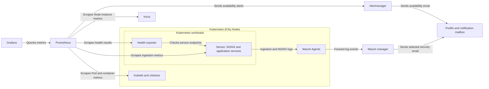
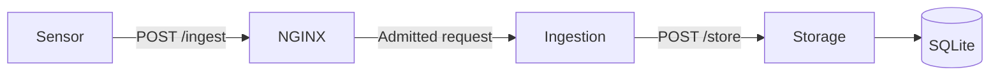

# Threat Monitoring

Threat Monitoring is a temperature telemetry application with availability monitoring and security controls. It accepts readings from a simulated sensor, stores them in SQLite, and exposes their average over HTTP.

## Architecture

### System overview

K3s runs the telemetry application and its health exporter. Prometheus, Grafana, Alertmanager, the Wazuh manager and the mail server run outside the cluster. Wazuh Agents on the K3s Nodes collect container logs.



### Reading path



Ingestion validates each reading and acknowledges it after storage accepts the write. Analytics reads the count and sum from storage to calculate the average. Registry holds service registrations in memory. Ingestion registers at startup and uses its configured storage URL for requests.

In Kubernetes, NGINX runs alongside ingestion and limits the request rate. Its metrics listener is separate from the ingestion listener. In local development the sensor connects directly to ingestion.

## Run locally

Use Python 3.13, the version used in the Docker images. From the repository root, create a virtual environment and install the [Python dependencies](requirements.txt).

```bash
# Create and activate an isolated Python environment
python3 -m venv .venv
source .venv/bin/activate

# Install the dependencies
python -m pip install --requirement requirements.txt
```

Start each process in a separate terminal from the repository root. Activate the same environment in each terminal. Start registry and storage before ingestion.

| Command | Purpose |
| --- | --- |
| `python registry.py` | Register and list services |
| `python storage.py` | Store readings and return statistics |
| `python ingestion.py` | Accept and validate readings |
| `python analytics.py` | Serve the average temperature |
| `python sensor.py` | Send simulated readings continuously |

To try the application with one reading, leave the sensor stopped. The first command writes a sample to local SQLite. The second reads the average of the stored readings.

```bash
# Submit one reading to the local ingestion service
curl --fail --silent --show-error \
  --header 'Content-Type: application/json' \
  --data '{"device_id":"sensor-demo","temperature":25.5}' \
  http://127.0.0.1:5001/ingest

# Read the current average from analytics
curl --fail --silent --show-error http://127.0.0.1:5003/average
```

Stop the processes with Ctrl+C. Storage keeps `readings.db` in its working directory and reuses it on the next start.

## Deploy to Kubernetes

The [manifests](deploy/k8s) target K3s and use the `threat-monitoring` namespace and a `local-path` storage class. Prepare both before applying the manifests.

1. Build the [application images](deploy/docker) from the repository root. Use the tags specified in the manifests and load each image, including the required NGINX image, on every Node eligible to run it. The workloads use `imagePullPolicy: Never`.
2. Apply the storage volume claim, storage and registry first. Once those services are available, apply ingestion, analytics, sensor and the monitoring endpoints.
3. Use the Node hosting the ingestion Pod for external requests to the [ingestion NodePort](deploy/k8s/ingestion.yaml). Its local traffic policy preserves the client address at NGINX.

Storage keeps SQLite on a single persistent volume. It retains readings across Pod replacement. Moving to another volume or namespace requires a data migration. Ingestion checks the structure of each reading. The deployment must provide the network boundary for client access.

## Monitoring and notifications

- Prometheus scrapes application health, ingestion request metrics and resource metrics. Its availability rules cover failed health checks, missing monitoring data and stopped readings. [Scrape configuration](monitoring/prometheus/prometheus.yml), [availability rules](monitoring/prometheus/rules/availability.yml)
- Grafana displays application health and resource use at Node, Pod and container level. [Dashboards and provisioning](monitoring/grafana)
- Alertmanager sends firing and resolved availability notifications through Postfix over SMTP with STARTTLS. Wazuh sends selected security alerts to the same mail service over plain SMTP on the private network. [Alertmanager configuration](monitoring/alertmanager/alertmanager.yml), [Wazuh mail settings](deploy/wazuh/project-email.conf)

Install the monitoring and mail services separately from the application workloads. Set scrape targets, the Grafana data source and SMTP settings for the deployment. The supplied Prometheus configuration expects Alertmanager on loopback. Configure the listener accordingly when they run on the same host.

The resource scrape jobs use a metrics client certificate for Incus and a dedicated ServiceAccount for kubelet metrics. Provision credentials and trusted certificates outside the repository. [Kubelet access manifest](deploy/k8s/kubelet-metrics-access.yaml)

## Security controls

| Event | Response | Configuration |
| --- | --- | --- |
| Repeated invalid readings | Ingestion rejects invalid readings. Wazuh correlates repeated rejections and temporarily blocks the source IP on the reporting Node. | [Ingestion rules](deploy/wazuh/ingestion-rules.xml), [Active Response](deploy/wazuh/ingestion-active-response.conf) |
| Excess ingestion traffic | NGINX rejects requests above its shared rate budget for the Pod. Wazuh records and counts the rejections. | [NGINX configuration](deploy/k8s/ingestion.yaml), [Wazuh rules](deploy/wazuh/nginx-rules.xml) |
| Spam sent to the notification mailbox | SpamAssassin marks spam and Procmail delivers it to Junk. Wazuh raises an alert from the mail log for each detection. Dovecot provides access to the mailbox over IMAP. | [Mail configuration](deploy/mail), [Wazuh mail rule](deploy/wazuh/mail-rules.xml) |

Install the Wazuh collectors on the hosts that produce the logs, and install the decoders and rules on the manager. Merge the settings for `ossec.conf` into the existing configuration. [Wazuh configuration](deploy/wazuh)
