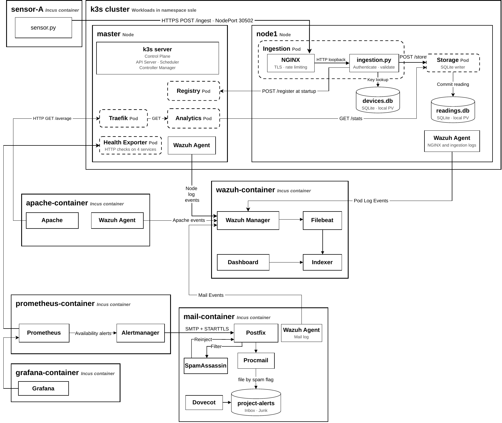
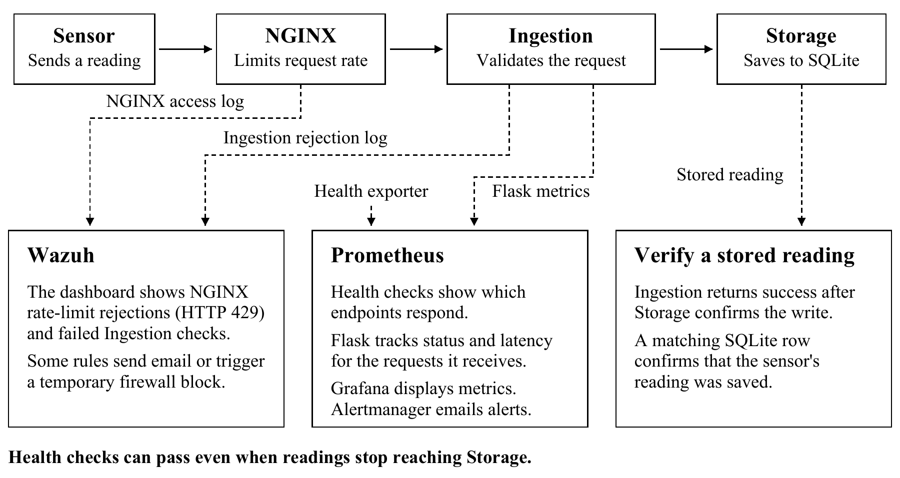

# Threat Monitoring

An SSLE lab project for collecting temperature readings and monitoring the availability and security of the services that handle them. A simulated sensor submits readings over HTTPS. Storage saves accepted readings in SQLite, and Analytics serves their average at `GET /average`.

## Architecture

In the Incus lab, K3s runs the application services. NGINX terminates TLS and limits requests to `POST /ingest`. Ingestion authenticates the sensor with a per-device API key, validates the reading and returns success after Storage confirms the write. Registry records the Ingestion service at startup.



The diagram shows the lab's `ssle` namespace. The repository manifests use `threat-monitoring`.

## Monitoring and security

Prometheus collects service health, ingestion and resource metrics. Grafana displays those metrics, and Alertmanager emails availability alerts. Wazuh collects application, NGINX, Apache and mail logs. Selected Wazuh rules send email or temporarily block a source IP. SpamAssassin classifies incoming mail, and Procmail files messages flagged as spam in Junk.



## Video demonstrations

- [Sensor spoofing and authentication](https://youtu.be/AoxhhDuXIVI)
- [Invalid temperature readings](https://youtu.be/Cd6UT-WFMFg)
- [Ingestion rate limiting](https://youtu.be/BF99Ci0xHdo)
- [Spam filtering](https://youtu.be/ACPS9eKxl5U)
- [Apache IP reputation and Shellshock detection](https://youtu.be/xFW0TtlRVsI)
- [Service availability in Grafana](https://youtu.be/mmURuOr33tI)

## Run locally

Use Python 3.13 and OpenSSL. From the repository root, create a virtual environment, generate a lab certificate and register a test sensor. The commands create a certificate directory, an API key file and a SQLite database for sensor credentials.

```sh
python3.13 -m venv .venv
source .venv/bin/activate
python -m pip install --requirement requirements.txt
bash deploy/tls/create-ingestion-tls.sh .ingestion-tls ingestion.lab.test
(umask 077 && set -C && python -m provision_sensor sensor-demo > .sensor-api-key)
```

In separate terminals, activate `.venv` and run the following commands from the repository root. Start Registry and Storage before Ingestion.

| Component | Command |
| --- | --- |
| Registry | `python registry.py` |
| Storage | `python storage.py` |
| Ingestion | `INGESTION_TLS_CERT=.ingestion-tls/tls.crt INGESTION_TLS_KEY=.ingestion-tls/tls.key python ingestion.py` |
| Analytics | `python analytics.py` |
| Sensor | `DEVICE_ID=sensor-demo SENSOR_API_KEY_FILE=.sensor-api-key INGESTION_CA_FILE=.ingestion-tls/ca.crt python sensor.py` |

Once the sensor reports an accepted reading, query the average with `curl --fail http://127.0.0.1:5003/average`. Stop the processes with Ctrl+C. The local SQLite databases retain the sensor registration and readings.

## Deployment configuration

- [Docker images](deploy/docker) and [K3s manifests](deploy/k8s) for the application and health exporter.
- [Monitoring configuration](monitoring) for Prometheus, Grafana and Alertmanager.
- [Wazuh configuration](deploy/wazuh) for log collection, rules and Active Response.
- [Apache configuration](deploy/kali) for the lab's average-temperature page and [mail configuration](deploy/mail) for alert delivery and spam filtering.

Both diagrams are from the SSLE project report.
